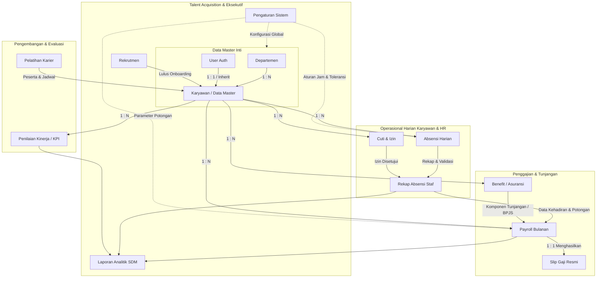

# SPESIFIKASI LOGIKA BISNIS (BUSINESS LOGIC SPECIFICATION)
## NEXORA HUMAN RESOURCE SOLUTIONS
**Dokumen Acuan Utama:** `Capstone Project.pdf` (Kelompok 5)  
**Status Dokumen:** Menunggu Persetujuan Stakeholder (Strict Business Logic Preservation)  
**Prinsip Kerja:** Tanpa Asumsi AI, Tanpa Perubahan Alur Bisnis Sepihak, Traceability Penuh, Zero Coding Sebelum Disetujui  

---

## 1. DEFINISI SISTEM, TUJUAN, DAN ARSITEKTUR PANEL

### 1.1 Definisi Sistem (Sesuai Bab 2 PDF)
Sistem informasi berbasis digital yang dirancang untuk mengotomatisasi, mengintegrasikan, dan mengelola seluruh proses administrasi sumber daya manusia (SDM) di perusahaan secara terpusat. Sistem ini bekerja secara tersentralisasi: seluruh data yang diinput oleh karyawan (seperti data absensi dan pengajuan cuti) langsung masuk ke dalam satu basis data utama (*database center*), yang kemudian diolah otomatis oleh sistem menjadi data siap pakai untuk keperluan penggajian (*payroll*) dan laporan manajemen bagi Admin HR.

### 1.2 Karakteristik Utama (Sesuai Bab 3 PDF)
Menggunakan pendekatan **Dual-Panel System** yang memisahkan area kerja manajemen (Admin HR) dan akses mandiri pegawai (Karyawan).

### 1.3 Tujuan dan Manfaat Sistem (Sesuai Bab 4 PDF)
- **Bagi Perusahaan / Manajemen HR:**
  1. Mengotomatisasi perhitungan gaji bulanan secara cepat dan akurat.
  2. Mempermudah monitoring kehadiran, kinerja, dan kebutuhan pelatihan staf.
  3. Menyediakan laporan analitik SDM yang valid untuk mendukung pengambilan keputusan.
- **Bagi Karyawan:**
  1. Memberikan kemandirian (*self-service*) dalam melakukan absensi harian dan memperbarui data profil.
  2. Mempercepat proses pengajuan izin, sakit, maupun cuti.
  3. Meningkatkan transparansi informasi terkait hak benefit dan rincian slip gaji.

### 1.4 Aktor Sistem (Sesuai Bab 5 PDF)
1. **Admin HR**: Pengguna manajemen dengan hak akses penuh ke modul pengelolaan operasional SDM, rekrutmen, payroll, analitik, dan pengaturan sistem.
2. **Karyawan**: Pegawai perusahaan dengan hak akses *self-service* (ESS) untuk profil mandiri, presensi, pengajuan cuti/izin, serta melihat hak benefit, slip gaji, evaluasi, dan pelatihan.

---

## 2. INVENTARISASI DIAGRAM SUMBER (CAPSTONE PROJECT.PDF)

### 2.1 Ringkasan Activity Diagram (Bab 6 PDF)
1. **Alur Login:**
   - Aktor (Admin HR / Karyawan) membuka aplikasi HRIS $\rightarrow$ input username & password $\rightarrow$ Sistem HRIS memvalidasi $\rightarrow$ Jika tidak valid, tampilkan pesan error $\rightarrow$ Jika valid, tampilkan Dashboard dengan menu sesuai role.
2. **Alur Admin HR (Kelola Data Karyawan & Menu):**
   - Admin HR memilih menu pada dashboard $\rightarrow$ Simpan/proses data $\rightarrow$ Sistem mengolah data sesuai menu $\rightarrow$ Jika gagal, tampilkan pesan gagal $\rightarrow$ Jika berhasil, tampilkan data/hasil pada dashboard.
3. **Alur Karyawan (Absensi, Profil, Pelatihan, Laporan):**
   - Karyawan memilih menu $\rightarrow$ Melakukan aksi sesuai menu (lihat data / ajukan / unduh) $\rightarrow$ Sistem mengambil data sesuai permintaan $\rightarrow$ Sistem menampilkan data ke pengguna $\rightarrow$ Karyawan melihat hasil.

### 2.2 Ringkasan Class Diagram (Bab 8 PDF)
Class Diagram terdiri dari 15 kelas dengan relasi spesifik:
1. `User` (Parent) $\rightarrow$ diwarisi (`Generalisasi`) oleh `AdminHR` dan `Karyawan`.
   - Atribut `User`: `id_user : int`, `nama : string`, `username : string`, `password : string`, `email : string`, `no_hp : string`, `role : string`, `status : string`. Method: `login(): boolean`, `logout(): void`, `ubahPassword(): void`.
   - `AdminHR` mewarisi `User`: Atribut `- nip : string`. Method fungsional: `kelolaDataKaryawan()`, `kelolaRekrutmen()`, `rekapAbsensi()`, `prosesPayroll()`, `kelolaBenefit()`, `penilaianKinerja()`, `kelolaPelatihan()`, `lihatLaporanAnalitik()`, `pengaturanSistem()`.
   - `Karyawan` mewarisi `User`: Atribut `- nip : string`. Method fungsional: `kelolaProfil()`, `absenDigital()`, `ajukanCutiIzin()`, `unduhSlipGaji()`, `lihatBenefit()`, `lihatEvaluasi()`, `lihatPelatihan()`.
2. `Departemen`: Atribut `id_dept : int`, `nama_dept : string`, `deskripsi : string`. Method: `tambah()`, `ubah()`, `hapus()`.
   - Relasi: `Departemen` [1] $\xrightarrow{memiliki}$ [0..*] `Karyawan` (Entity).
3. `Karyawan` (Entitas Data Master):
   - Atribut: `id_karyawan : int`, `nip : string`, `nama : string`, `tgl_lahir : date`, `jk : string`, `alamat : string`, `status_kerja : string`, `id_dept : int`. Method: `tambah()`, `ubah()`, `hapus()`.
   - Relasi:
     - [1] `Karyawan` $\xrightarrow{melakukan}$ [0..*] `Absensi`
     - [1] `Karyawan` $\xrightarrow{mengajukan}$ [0..*] `CutiIzin`
     - [1] `Karyawan` $\xrightarrow{memiliki}$ [0..*] `Payroll`
4. `Absensi`: Atribut `id_absensi : int`, `id_karyawan : int`, `tanggal : date`, `status : string`, `keterangan : string`. Method: `inputAbsen()`, `lihatRekap()`.
5. `CutiIzin`: Atribut `id_cuti_izin : int`, `id_karyawan : int`, `jenis : string`, `tanggal_mulai : date`, `tanggal_selesai : date`, `status : string`, `keterangan : string`. Method: `ajukan()`, `ubahStatus()`, `hapus()`.
6. `Payroll`: Atribut `id_payroll : int`, `id_karyawan : int`, `periode : string`, `gaji_pokok : decimal`, `tunjangan : decimal`, `potongan : decimal`, `total_gaji : decimal`, `status : string`. Method: `prosesPayroll()`, `lihatSlipGaji()`.
   - Relasi: `Payroll` [1] $\xrightarrow{menghasilkan}$ [1] `SlipGaji`.
7. `SlipGaji`: Atribut `id_slip : int`, `id_payroll : int`, `periode : string`, `tgl_cetak : date`, `file_slip : string`. Method: `generate()`, `unduh()`.
8. `Rekrutmen`: Atribut `id_rekrutmen : int`, `posisi : string`, `tgl_buka : date`, `tgl_tutup : date`, `status : string`. Method: `tambah()`, `ubah()`, `hapus()`.
9. `Benefit`: Atribut `id_benefit : int`, `id_karyawan : int`, `jenis_benefit : string`, `nilai : decimal`, `periode : string`. Method: `kelolaBenefit()`, `lihatBenefit()`.
10. `Pelatihan`: Atribut `id_pelatihan : int`, `nama_pelatihan : string`, `tanggal : date`, `lokasi : string`, `peserta : int`. Method: `tambah()`, `ubah()`, `hapus()`.
11. `PenilaianKinerja`: Atribut `id_penilaian : int`, `id_karyawan : int`, `periode : string`, `nilai : decimal`, `catatan : string`. Method: `inputNilai()`, `lihatHasil()`.
12. `LaporanAnalitik`: Atribut `id_laporan : int`, `jenis : string`, `periode : string`, `tanggal_generate : date`, `file_laporan : string`. Method: `generate()`, `unduh()`.
13. `PengaturanSistem`: Atribut `id_setting : int`, `nama_setting : string`, `nilai : string`, `deskripsi : string`. Method: `ubahSetting()`, `reset()`.

---

## 3. PEMETAAN LENGKAP 17 USE CASE (BUSINESS LOGIC SPECIFICATION)

Berikut adalah spesifikasi mendalam dari seluruh 17 Use Case yang tercantum pada tabel Bab 5 PDF, dilengkapi alur proses, validasi faktual, keterhubungan, serta identifikasi `BUSINESS DECISION REQUIRED` dan `BUSINESS LOGIC CONFLICT`.

```
TRACEABILITY FORMAT:
PDF Use Case → Business Requirement ID → User Story → API / Database → Frontend Panel → Test Case → Acceptance Criteria
```

---

### USE CASE 01: Login
- **Traceability Matrix:**
  - **PDF Source:** Use Case No. 1 ("Login")
  - **Business Requirement ID:** `BR-AUTH-001`
  - **User Story:** Sebagai Admin HR atau Karyawan, saya ingin memasukkan username dan password agar dapat diautentikasi dan mengakses dashboard sesuai hak akses saya.
  - **API Target:** `POST /api/v1/auth/login`, `POST /api/v1/auth/logout`
  - **Database Mapping:** Entitas `User` (`username`, `password`, `role`, `status`)
  - **Frontend Panel:** `/login` $\rightarrow$ Redirect ke `/admin` (jika role Admin HR) atau `/ess` (jika role Karyawan)
  - **Test Case:** `TC-AUTH-001` (Login valid), `TC-AUTH-002` (Login invalid), `TC-AUTH-003` (Pemisahan akses role)
  - **Acceptance Criteria:** Pengguna dengan kredensial sah berhasil masuk ke dashboard yang sesuai; kredensial salah menghasilkan notifikasi error tanpa kebocoran data sensitif.
- **Aktor:** Admin HR & Karyawan
- **Input Data:** `username : string`, `password : string`
- **Alur Proses:**
  1. Aktor membuka antarmuka login HRIS.
  2. Aktor mengisi username dan password, lalu mengirim formulir (*submit*).
  3. Sistem memvalidasi kredensial terhadap data akun di database center.
  4. Jika data tidak valid: Sistem menampilkan pesan error dan aktor tetap berada di halaman login.
  5. Jika data valid: Sistem menentukan role pengguna (Admin HR atau Karyawan) dan mengarahkan ke dashboard yang relevan.
- **Output Data:** Status autentikasi berhasil, token/sesi pengguna, antarmuka dashboard sesuai hak akses role.
- **Validasi Diketahui (Faktual PDF):** Username dan password wajib cocok dengan basis data; sistem menolak autentikasi jika tidak cocok.
- **Hubungan Antarproses:** Gerbang utama (*gatekeeper*) sebelum mengakses 16 use case lainnya.
- **`BUSINESS DECISION REQUIRED`:**
  1. Mekanisme penanganan akun terkunci: Berapa kali batas percobaan gagal login sebelum akun diblokir sementara?
  2. Kebijakan pergantian password (*ubahPassword*): Apakah ada standar minimum panjang dan kompleksitas karakter password?
  3. Format identifier login: Apakah login mendukung login via email selain username?
- **`BUSINESS LOGIC CONFLICT`:**
  - *Conflict-AUTH-01*: PDF mendefinisikan field `username`, sedangkan implementasi basis data eksisting menggunakan `email` sebagai identifier unik utama.

---

### USE CASE 02: Kelola Data Karyawan
- **Traceability Matrix:**
  - **PDF Source:** Use Case No. 2 ("Kelola data karyawan")
  - **Business Requirement ID:** `BR-EMP-001`
  - **User Story:** Sebagai Admin HR, saya ingin menginput, memperbarui, dan menonaktifkan data master pegawai agar catatan kepegawaian perusahaan selalu mutakhir dan valid.
  - **API Target:** `GET /api/v1/employees`, `POST /api/v1/employees`, `PUT /api/v1/employees/:id`, `PATCH /api/v1/employees/:id/status`
  - **Database Mapping:** Entitas `Karyawan` (`id_karyawan`, `nip`, `nama`, `tgl_lahir`, `jk`, `alamat`, `status_kerja`, `id_dept`), Entitas `Departemen`
  - **Frontend Panel:** Admin Panel (`/admin/employees`)
  - **Test Case:** `TC-EMP-001` (Tambah karyawan), `TC-EMP-002` (Ubah karyawan), `TC-EMP-003` (Nonaktifkan karyawan)
  - **Acceptance Criteria:** Admin dapat menambah karyawan dengan NIP unik dan departemen valid, mengubah biodata/status, serta menonaktifkan karyawan tanpa merusak integritas data historis.
- **Aktor:** Admin HR
- **Input Data:** `nip`, `nama`, `tgl_lahir`, `jk` (jenis kelamin), `alamat`, `status_kerja`, `id_dept`
- **Alur Proses:**
  1. Admin HR membuka menu Kelola Data Karyawan pada dashboard.
  2. Admin HR memilih aksi: Tambah, Ubah, atau Hapus/Nonaktifkan data pegawai.
  3. Admin HR mengisi/memperbarui data pada formulir dan melakukan penyimpanan data.
  4. Sistem memproses penyimpanan dan validasi relasi departemen.
  5. Sistem menampilkan konfirmasi keberhasilan dan memperbarui daftar data master karyawan.
- **Output Data:** Catatan master karyawan tersimpan/terperbarui; daftar karyawan aktif dan nonaktif.
- **Validasi Diketahui (Faktual PDF):** NIP terdaftar; relasi departemen (`id_dept`) valid; status kerja terdefinisi.
- **Hubungan Antarproses:** Menjadi data induk (*single source of truth*) yang mutlak dibutuhkan oleh modul Absensi, Cuti, Payroll, Benefit, Evaluasi Kinerja, dan Pelatihan.
- **`BUSINESS DECISION REQUIRED`:**
  1. Format penomoran NIP: Apakah NIP digenerate otomatis berdasarkan pola tertentu (misal: Tahun-Dept-Urutan) atau diinput manual oleh Admin HR?
  2. Opsi status kerja: Nilai pasti untuk `status_kerja` (misal: Tetap, Kontrak/PKWT, Magang, Percobaan, Berhenti)?
  3. Konsep penghapusan (*hapus*): Apakah diizinkan *hard delete* atau wajib *soft delete / deactivation* untuk menjaga integritas data riwayat absensi dan penggajian masa lalu?
- **`BUSINESS LOGIC CONFLICT`:**
  - *Conflict-EMP-01*: Class Diagram PDF memiliki dua representasi Karyawan: satu sebagai subclass dari `User` (berisi method self-service), dan satu lagi sebagai entitas tabel `Karyawan` (berisi data demografi dan relasi ke Departemen). Di kode eksisting, entitas `User` dan `Employee` dihubungkan via 1-to-1 foreign key relasional.

---

### USE CASE 03: Kelola Rekrutmen
- **Traceability Matrix:**
  - **PDF Source:** Use Case No. 3 ("Kelola rekrutmen")
  - **Business Requirement ID:** `BR-REC-001`
  - **User Story:** Sebagai Admin HR, saya ingin mengatur proses seleksi pelamar baru dari pembukaan posisi hingga tahap onboarding agar pemenuhan kebutuhan tenaga kerja berjalan terstruktur.
  - **API Target:** `GET /api/v1/recruitment`, `POST /api/v1/recruitment`, `PUT /api/v1/recruitment/:id`, `PATCH /api/v1/recruitment/:id/status`
  - **Database Mapping:** Entitas `Rekrutmen` (`id_rekrutmen`, `posisi`, `tgl_buka`, `tgl_tutup`, `status`)
  - **Frontend Panel:** Admin Panel (`/admin/recruitment`)
  - **Test Case:** `TC-REC-001` (Buka lowongan), `TC-REC-002` (Ubah status tahap seleksi), `TC-REC-003` (Tutup lowongan)
  - **Acceptance Criteria:** Posisi lowongan dapat dibuat dengan rentang tanggal buka/tutup, status lowongan dapat diperbarui hingga tahap onboarding.
- **Aktor:** Admin HR
- **Input Data:** `posisi : string`, `tgl_buka : date`, `tgl_tutup : date`, `status : string`
- **Alur Proses:**
  1. Admin HR membuka menu Kelola Rekrutmen.
  2. Admin HR membuat lowongan baru atau memilih data seleksi yang ada.
  3. Admin HR memperbarui status seleksi kandidat/lowongan hingga tahap onboarding.
  4. Sistem menyimpan data rekrutmen ke basis data dan menampilkan pembaharuan status.
- **Output Data:** Data lowongan pekerjaan dan status tahapan seleksi pelamar tersimpan.
- **Validasi Diketahui (Faktual PDF):** Tanggal buka dan tutup wajib valid; status lowongan terdefinisi.
- **Hubungan Antarproses:** Pelamar yang menyelesaikan tahap onboarding menjadi calon entitas baru pada modul Kelola Data Karyawan.
- **`BUSINESS DECISION REQUIRED`:**
  1. Alur detail seleksi pelamar: Use case menyebutkan "mengatur proses seleksi pelamar baru hingga tahap onboarding", namun tabel `Rekrutmen` pada Class Diagram hanya memuat field level lowongan (`posisi`, `tgl_buka`, `tgl_tutup`, `status`). Apakah data nama pelamar, resume/CV, dan tahapan seleksi (Screening, Interview, Onboarding) disimpan dalam tabel terpisah atau dalam model yang lebih detail?
  2. Mekanisme Onboarding to Employee: Apakah ada tombol aksi otomatis untuk mengonversi kandidat lulus onboarding langsung menjadi draft Karyawan baru?
- **`BUSINESS LOGIC CONFLICT`:**
  - *Conflict-REC-01*: Modul Rekrutmen belum tersedia di database schema Prisma dan belum ada di antarmuka Admin saat ini.

---

### USE CASE 04: Rekap Absensi Staf
- **Traceability Matrix:**
  - **PDF Source:** Use Case No. 4 ("Rekap absensi staf")
  - **Business Requirement ID:** `BR-ATT-002`
  - **User Story:** Sebagai Admin HR, saya ingin memantau, memvalidasi, dan merekap jam masuk serta jam pulang seluruh staf agar kedisiplinan kerja terpantau dan data siap dihitung pada proses payroll.
  - **API Target:** `GET /api/v1/attendance/summary`, `POST /api/v1/attendance/validate`
  - **Database Mapping:** Entitas `Absensi` (`id_absensi`, `id_karyawan`, `tanggal`, `status`, `keterangan`), Entitas `Karyawan`
  - **Frontend Panel:** Admin Panel (`/admin/attendance`)
  - **Test Case:** `TC-ATT-003` (Filter rekap absensi per periode), `TC-ATT-004` (Validasi kehadiran oleh HR)
  - **Acceptance Criteria:** Admin HR dapat melihat rekap kehadiran harian/bulanan seluruh karyawan dan memvalidasi anomali kehadiran.
- **Aktor:** Admin HR
- **Input Data:** Filter periode tanggal, filter departemen, filter status kehadiran (`status`), data koreksi/validasi absensi.
- **Alur Proses:**
  1. Admin HR mengakses menu Rekap Absensi Staf.
  2. Sistem menampilkan data akumulasi kehadiran (jam masuk, jam pulang, status kehadiran) dari seluruh karyawan.
  3. Admin HR memeriksa dan memvalidasi keabsahan data presensi.
  4. Data kehadiran yang telah divalidasi tersimpan siap pakai untuk pengolahan payroll.
- **Output Data:** Rekapitulasi absensi staf (hadir, terlambat, izin, sakit, alpa) per periode.
- **Validasi Diketahui (Faktual PDF):** Data kehadiran terikat pada `id_karyawan` dan tanggal kalender kerja yang valid.
- **Hubungan Antarproses:** Menerima data dari Use Case 12 (Absensi Digital Karyawan) dan Use Case 13 (Cuti/Izin), lalu menjadi input data krusial bagi Use Case 5 (Proses Payroll).
- **`BUSINESS DECISION REQUIRED`:**
  1. Kebijakan toleransi keterlambatan (*grace period*): Berapa menit toleransi keterlambatan sebelum dikategorikan "Terlambat"?
  2. Kebijakan validasi manual: Apakah Admin HR diizinkan mengubah status kehadiran secara manual jika terjadi kendala teknis perangkat karyawan?
- **`BUSINESS LOGIC CONFLICT`:**
  - *Conflict-ATT-01*: Pada deskripsi Use Case 4 tertulis "merekap jam masuk/pulang semua staf", tetapi tabel `Absensi` pada Class Diagram PDF hanya memuat atribut `tanggal`, `status`, dan `keterangan` (tanpa kolom waktu spesifik `jam_masuk` dan `jam_pulang`).

---

### USE CASE 05: Proses Payroll
- **Traceability Matrix:**
  - **PDF Source:** Use Case No. 5 ("Proses payroll")
  - **Business Requirement ID:** `BR-PAY-001`
  - **User Story:** Sebagai Admin HR, saya ingin memproses perhitungan gaji bulanan secara otomatis berdasarkan rekapan absensi agar gaji bersih dihitung cepat, akurat, dan transparan.
  - **API Target:** `POST /api/v1/payroll/calculate`, `GET /api/v1/payroll/periods`, `POST /api/v1/payroll/lock`
  - **Database Mapping:** Entitas `Payroll` (`id_payroll`, `id_karyawan`, `periode`, `gaji_pokok`, `tunjangan`, `potongan`, `total_gaji`, `status`), Entitas `SlipGaji`
  - **Frontend Panel:** Admin Panel (`/admin/payroll`)
  - **Test Case:** `TC-PAY-001` (Kalkulasi payroll periodik), `TC-PAY-002` (Konsistensi total_gaji = pokok + tunjangan - potongan)
  - **Acceptance Criteria:** Sistem mengkalkulasi komponen gaji untuk seluruh karyawan aktif pada periode terkait, menghasilkan catatan payroll dengan status yang jelas dan otomatis menerbitkan slip gaji.
- **Aktor:** Admin HR
- **Input Data:** `periode : string`, pemicu proses kalkulasi (*trigger run payroll*), penyesuaian nominal (jika ada).
- **Alur Proses:**
  1. Admin HR membuka menu Proses Payroll dan menentukan periode penggajian.
  2. Admin HR memicu aksi `prosesPayroll()`.
  3. Sistem menarik data gaji pokok, tunjangan, data rekap absensi, dan potongan terkait.
  4. Sistem melakukan komputasi nilai: `total_gaji = gaji_pokok + tunjangan - potongan`.
  5. Sistem menyimpan catatan `Payroll` dan secara otomatis menghasilkan relasi 1-to-1 ke entitas `SlipGaji`.
  6. Admin HR memverifikasi hasil kalkulasi pada dashboard payroll.
- **Output Data:** Catatan `Payroll` per karyawan untuk periode terkait dan dokumen `SlipGaji`.
- **Validasi Diketahui (Faktual PDF):** Data karyawan berstatus aktif; periode terdefinisi; formula dasar komponen: Gaji Pokok, Tunjangan, Potongan, Total Gaji.
- **Hubungan Antarproses:** Bergantung penuh pada Use Case 2 (Data Karyawan), Use Case 4 (Rekap Absensi), Use Case 6 (Benefit); serta menjadi penyedia data untuk Use Case 14 (Unduh Slip Gaji oleh Karyawan).
- **`BUSINESS DECISION REQUIRED`:**
  1. **Formula Pengurangan Absensi (POTONGAN):** Berapa potongan gaji untuk setiap hari alpa / tanpa keterangan? Apakah keterlambatan menit dipotong dari tunjangan atau gaji pokok?
  2. **Formula Tunjangan:** Apakah tunjangan bersifat tetap per bulan (*fixed*) atau proporsional kehadiran harian (*attendance-based*)?
  3. **Formula Pajak (PPh 21) & Iuran BPJS:** Apakah potongan pajak dan BPJS dimasukkan ke dalam atribut `potongan` umum atau dihitung terpisah?
  4. **Cut-off Date:** Tanggal cut-off siklus absensi bulanan untuk payroll (misal tanggal 21 s/d 20 bulan berikutnya, atau tanggal 1 s/d akhir bulan)?
- **`BUSINESS LOGIC CONFLICT`:**
  - *Conflict-PAY-01*: Di database eksisting telah ada tabel detail `payroll_items`, `salary_components`, pajak PPh21, BPJS TK, BPJS Kes. Sedangkan di Class Diagram PDF hanya mencakup 4 agregat nominal: `gaji_pokok`, `tunjangan`, `potongan`, `total_gaji`.

---

### USE CASE 06: Kelola Benefit
- **Traceability Matrix:**
  - **PDF Source:** Use Case No. 6 ("Kelola benefit")
  - **Business Requirement ID:** `BR-BEN-001`
  - **User Story:** Sebagai Admin HR, saya ingin mengonfigurasi alokasi asuransi, BPJS, dan bonus perusahaan untuk karyawan agar hak kompensasi dan jaminan kesehatan terdata dengan tertib.
  - **API Target:** `GET /api/v1/benefits`, `POST /api/v1/benefits`, `PUT /api/v1/benefits/:id`
  - **Database Mapping:** Entitas `Benefit` (`id_benefit`, `id_karyawan`, `jenis_benefit`, `nilai`, `periode`)
  - **Frontend Panel:** Admin Panel (`/admin/benefits`)
  - **Test Case:** `TC-BEN-001` (Alokasi benefit baru ke karyawan), `TC-BEN-002` (Update nilai plafon benefit)
  - **Acceptance Criteria:** Admin dapat menetapkan dan mengubah alokasi benefit (asuransi/BPJS/bonus) per karyawan dan per periode.
- **Aktor:** Admin HR
- **Input Data:** `id_karyawan : int`, `jenis_benefit : string` (Asuransi, BPJS, Bonus), `nilai : decimal`, `periode : string`
- **Alur Proses:**
  1. Admin HR memilih menu Kelola Benefit pada dashboard.
  2. Admin HR memilih karyawan dan menginput/mengonfigurasi jenis serta besaran alokasi benefit.
  3. Sistem menyimpan konfigurasi benefit ke basis data.
  4. Sistem memperbarui ringkasan alokasi benefit per divisi atau per individu.
- **Output Data:** Data master alokasi benefit karyawan yang aktif pada periode berjalan.
- **Validasi Diketahui (Faktual PDF):** Karyawan terdaftar; nilai benefit bertipe desimal non-negatif; periode valid.
- **Hubungan Antarproses:** Menghubungkan alokasi benefit ke Use Case 5 (komponen tunjangan/potongan Payroll) dan Use Case 15 (Lihat Benefit oleh Karyawan).
- **`BUSINESS DECISION REQUIRED`:**
  1. Kebijakan Plafon Asuransi: Apakah nilai benefit asuransi kesehatan merupakan kuota plafon tahunan yang berkurang saat ada klaim (*reimbursement*), atau premi bulanan yang dibayarkan perusahaan?
  2. Kebijakan BPJS: Berapa proporsi persentase yang ditanggung perusahaan vs yang dipotong dari gaji karyawan?
- **`BUSINESS LOGIC CONFLICT`:**
  - *Conflict-BEN-01*: Tabel `Benefit` belum ada dalam skema database Prisma saat ini.

---

### USE CASE 07: Penilaian Kinerja
- **Traceability Matrix:**
  - **PDF Source:** Use Case No. 7 ("Penilaian Kinerja")
  - **Business Requirement ID:** `BR-PRF-001`
  - **User Story:** Sebagai Admin HR, saya ingin menginput hasil evaluasi kerja berkala (KPI) tiap divisi agar rekam jejak performa pegawai terdokumentasi secara objektif.
  - **API Target:** `GET /api/v1/performance`, `POST /api/v1/performance`, `PUT /api/v1/performance/:id`
  - **Database Mapping:** Entitas `PenilaianKinerja` (`id_penilaian`, `id_karyawan`, `periode`, `nilai`, `catatan`)
  - **Frontend Panel:** Admin Panel (`/admin/performance`)
  - **Test Case:** `TC-PRF-001` (Input nilai KPI karyawan), `TC-PRF-002` (Validasi rentang nilai)
  - **Acceptance Criteria:** Admin HR berhasil menyimpan nilai evaluasi dan catatan kinerja per karyawan per periode; riwayat evaluasi tersimpan permanen.
- **Aktor:** Admin HR
- **Input Data:** `id_karyawan : int`, `periode : string`, `nilai : decimal`, `catatan : string`
- **Alur Proses:**
  1. Admin HR membuka menu Penilaian Kinerja.
  2. Admin HR memilih karyawan dan periode evaluasi yang bersangkutan.
  3. Admin HR memasukkan nilai angka KPI dan catatan evaluasi kualitatif.
  4. Sistem memvalidasi dan menyimpan data ke tabel penilaian kinerja.
  5. Sistem memperbarui status evaluasi kinerja karyawan.
- **Output Data:** Catatan penilaian kinerja terverifikasi pada database.
- **Validasi Diketahui (Faktual PDF):** Data terikat pada karyawan aktif; periode evaluasi valid; nilai bertipe desimal.
- **Hubungan Antarproses:** Menjadi data masukan bagi Use Case 16 (Lihat Evaluasi oleh Karyawan), rekomendasi Use Case 8 (Pelatihan Karier), serta pertimbangan bonus pada Use Case 6/5.
- **`BUSINESS DECISION REQUIRED`:**
  1. Standar Skala Nilai: Apakah nilai KPI menggunakan skala angka 0–100, skala 1.00–5.00, atau grade huruf (A, B, C, D, E)?
  2. Sumber Penilai: Apakah evaluasi diisi langsung oleh Admin HR, atau Admin HR hanya merekap skor yang diisi oleh Manager Divisi masing-masing?
- **`BUSINESS LOGIC CONFLICT`:**
  - *Conflict-PRF-01*: Entitas `PenilaianKinerja` belum terdapat di schema Prisma saat ini.

---

### USE CASE 08: Kelola Pelatihan
- **Traceability Matrix:**
  - **PDF Source:** Use Case No. 8 ("Kelola pelatihan")
  - **Business Requirement ID:** `BR-TRN-001`
  - **User Story:** Sebagai Admin HR, saya ingin menyusun program, jadwal, dan daftar peserta pelatihan karier agar pengembangan kompetensi karyawan berjalan terencana.
  - **API Target:** `GET /api/v1/training`, `POST /api/v1/training`, `PUT /api/v1/training/:id`, `DELETE /api/v1/training/:id`
  - **Database Mapping:** Entitas `Pelatihan` (`id_pelatihan`, `nama_pelatihan`, `tanggal`, `lokasi`, `peserta`)
  - **Frontend Panel:** Admin Panel (`/admin/training`)
  - **Test Case:** `TC-TRN-001` (Tambah program pelatihan), `TC-TRN-002` (Ubah jadwal pelatihan), `TC-TRN-003` (Hapus program pelatihan)
  - **Acceptance Criteria:** Program pelatihan berhasil dibuat memuat nama kegiatan, tanggal pelaksanaan, lokasi, dan batas kuota peserta.
- **Aktor:** Admin HR
- **Input Data:** `nama_pelatihan : string`, `tanggal : date`, `lokasi : string`, `peserta : int` (kuota/jumlah peserta)
- **Alur Proses:**
  1. Admin HR mengakses menu Kelola Pelatihan.
  2. Admin HR memilih aksi `tambah()`, `ubah()`, atau `hapus()`.
  3. Admin HR mengisi formulir nama pelatihan, tanggal kegiatan, lokasi, serta kapasitas peserta.
  4. Sistem memproses penyimpanan program pelatihan.
  5. Program pelatihan tampil pada daftar kegiatan pelatihan aktif.
- **Output Data:** Jadwal dan informasi program pelatihan tersimpan di database.
- **Validasi Diketahui (Faktual PDF):** Tanggal pelatihan valid; kuota peserta bernilai integer non-negatif.
- **Hubungan Antarproses:** Menjadi katalog program pengembangan yang ditampilkan pada Use Case 17 (Lihat Pelatihan oleh Karyawan).
- **`BUSINESS DECISION REQUIRED`:**
  1. Manajemen Daftar Peserta: Pada Class Diagram, atribut `peserta` bertipe `int` (kapasitas/jumlah). Bagaimana sistem memetakan *siapa saja karyawan* yang menjadi peserta (tabel relasi `PesertaPelatihan` / `TrainingEnrollment`)?
  2. Status Wajib vs Pilihan: Bagaimana membedakan antara "jadwal diklat wajib" dan "tawaran kelas kompetensi pilihan" sebagaimana disebut di Use Case 17?
- **`BUSINESS LOGIC CONFLICT`:**
  - *Conflict-TRN-01*: Modul dan tabel `Pelatihan` belum tersedia di schema Prisma.

---

### USE CASE 09: Lihat Laporan Analitik
- **Traceability Matrix:**
  - **PDF Source:** Use Case No. 9 ("Lihat lap. analitik")
  - **Business Requirement ID:** `BR-REP-001`
  - **User Story:** Sebagai Admin HR, saya ingin memantau grafik statistik SDM dan mengunduh laporan bulanan agar memiliki data valid untuk mendukung pengambilan keputusan manajemen.
  - **API Target:** `GET /api/v1/reports/analytics`, `POST /api/v1/reports/generate`, `GET /api/v1/reports/download/:id`
  - **Database Mapping:** Entitas `LaporanAnalitik` (`id_laporan`, `jenis`, `periode`, `tanggal_generate`, `file_laporan`)
  - **Frontend Panel:** Admin Panel (`/admin/reports`)
  - **Test Case:** `TC-REP-001` (Tampilkan visualisasi analitik), `TC-REP-002` (Generate dan unduh file laporan)
  - **Acceptance Criteria:** Admin HR dapat melihat grafik tren SDM (kehadiran, turnover, biaya) dan mengunduh berkas laporan bulanan resmi.
- **Aktor:** Admin HR
- **Input Data:** Pilihan jenis laporan (`jenis`), periode laporan (`periode`), aksi filter tanggal.
- **Alur Proses:**
  1. Admin HR membuka menu Laporan Analitik pada dashboard.
  2. Sistem melakukan agregasi data dari modul Absensi, Karyawan, dan Payroll.
  3. Sistem merender visualisasi grafik analitik SDM.
  4. Admin HR menekan tombol `generate()` atau `unduh()`.
  5. Sistem menyusun berkas laporan (`file_laporan`) dan mencatat riwayat pada entitas `LaporanAnalitik`.
- **Output Data:** Tampilan dashboard statistik grafis dan berkas laporan bulanan yang siap diunduh.
- **Validasi Diketahui (Faktual PDF):** Periode laporan valid; berkas laporan tersimpan dalam sistem.
- **Hubungan Antarproses:** Mengonsumsi data agregat dari seluruh modul operasional (Karyawan, Absensi, Cuti, Payroll, Kinerja).
- **`BUSINESS DECISION REQUIRED`:**
  1. Format File Laporan: Apakah format berkas `file_laporan` wajib PDF, spreadsheet Excel (XLSX), atau CSV?
  2. Jenis Metrik Wajib: Metrik statistik apa saja yang wajib muncul di grafik (misal: Rasio Kehadiran %, Turn-over Rate, Total Pengeluaran Payroll bulanan, Rasio Gender/Departemen)?
- **`BUSINESS LOGIC CONFLICT`:**
  - *Conflict-REP-01*: Entitas `LaporanAnalitik` belum tersinkronisasi sebagai tabel persisten di Prisma (saat ini hanya ada controller agregasi runtime).

---

### USE CASE 10: Pengaturan Sistem
- **Traceability Matrix:**
  - **PDF Source:** Use Case No. 10 ("Pengaturan sistem")
  - **Business Requirement ID:** `BR-SET-001`
  - **User Story:** Sebagai Admin HR, saya ingin mengatur konfigurasi dasar aplikasi dan pembagian hak user agar parameter operasional HRIS berjalan sesuai kebijakan perusahaan.
  - **API Target:** `GET /api/v1/settings`, `PUT /api/v1/settings/:id`, `POST /api/v1/settings/reset`
  - **Database Mapping:** Entitas `PengaturanSistem` (`id_setting`, `nama_setting`, `nilai`, `deskripsi`)
  - **Frontend Panel:** Admin Panel (`/admin/settings`)
  - **Test Case:** `TC-SET-001` (Ubah nilai setting), `TC-SET-002` (Reset ke nilai bawaan)
  - **Acceptance Criteria:** Admin HR dapat memperbarui nilai konfigurasi sistem dan melakukan reset ke nilai default.
- **Aktor:** Admin HR
- **Input Data:** `id_setting : int`, `nama_setting : string`, `nilai : string`, `deskripsi : string`
- **Alur Proses:**
  1. Admin HR mengakses menu Pengaturan Sistem.
  2. Sistem menampilkan daftar parameter konfigurasi aplikasi saat ini.
  3. Admin HR mengubah parameter yang diinginkan (`ubahSetting()`) atau mengembalikan ke default (`reset()`).
  4. Sistem memvalidasi perubahan dan memperbarui nilai di database.
  5. Konfigurasi baru langsung berlaku pada sistem.
- **Output Data:** Parameter konfigurasi sistem terbaharui.
- **Validasi Diketahui (Faktual PDF):** Nilai setting sesuai tipe parameter; riwayat setting tersimpan.
- **Hubungan Antarproses:** Menjadi acuan global bagi modul Absensi (jam kerja), Payroll (parameter hitungan), dan Hak Akses Pengguna.
- **`BUSINESS DECISION REQUIRED`:**
  1. Daftar Parameter Bawaan: Kunci setting apa saja yang wajib ada (misal: `DEFAULT_WORK_START`, `DEFAULT_WORK_END`, `MAX_LATE_MINUTES`, `COMPANY_NAME`)?
  2. Batasan Pembagian Hak User: Dalam deskripsi tertulis "pembagian hak user", apakah konfigurasi mencakup pembuatan role kustom atau hanya toggle perizinan role Admin vs Karyawan?
- **`BUSINESS LOGIC CONFLICT`:**
  - *Conflict-SET-01*: Di database ada `SystemSetting` dengan field `key, value, group, description`. Di Class Diagram PDF parameternya adalah `id_setting, nama_setting, nilai, deskripsi`.

---

### USE CASE 11: Kelola Profil Mandiri
- **Traceability Matrix:**
  - **PDF Source:** Use Case No. 11 ("Kelola profil mandiri")
  - **Business Requirement ID:** `BR-ESS-EMP-001`
  - **User Story:** Sebagai Karyawan, saya ingin mengubah data personal yang bersifat dinamis (alamat, nomor HP) melalui portal mandiri agar data kontak pribadi saya selalu akurat tanpa harus mengajukan form manual ke HR.
  - **API Target:** `GET /api/v1/ess/profile`, `PUT /api/v1/ess/profile`
  - **Database Mapping:** Entitas `User` (`no_hp`, `email`), Entitas `Karyawan` (`alamat`)
  - **Frontend Panel:** Employee Self-Service / ESS Panel (`/ess/profile`)
  - **Test Case:** `TC-ESS-EMP-001` (Karyawan mengubah alamat dan no HP), `TC-ESS-EMP-002` (Blokir modifikasi data non-dinamis seperti NIP, Dept, Gaji)
  - **Acceptance Criteria:** Karyawan berhasil memperbarui alamat dan nomor telepon pribadi; data terisolasi hanya pada profil miliknya sendiri.
- **Aktor:** Karyawan
- **Input Data:** `alamat : string`, `no_hp : string`, (opsional: email pribadi, kontak darurat jika diizinkan)
- **Alur Proses:**
  1. Karyawan memilih menu Profil Mandiri pada dashboard ESS.
  2. Sistem menampilkan data profil karyawan saat ini.
  3. Karyawan memperbarui data personal yang diizinkan (alamat, nomor HP).
  4. Sistem memvalidasi format input dan menyimpan perubahan ke basis data.
  5. Sistem menampilkan notifikasi sukses dan menampilkan data terbaru.
- **Output Data:** Catatan kontak dan alamat karyawan terbarui di database utama.
- **Validasi Diketahui (Faktual PDF):** Karyawan hanya berhak mengubah data personal yang bersifat **dinamis** (secara tegas dibatasi pada: alamat, nomor HP). Data struktural seperti NIP, nama, tanggal lahir, status kerja, dan departemen dikunci (*read-only* bagi karyawan).
- **Hubungan Antarproses:** Memperbarui data kontak pada modul Kelola Data Karyawan (Admin HR).
- **`BUSINESS DECISION REQUIRED`:**
  1. Alur Persetujuan Perubahan: Apakah perubahan alamat/nomor HP langsung berlaku otomatis (*instant update*), atau memerlukan konfirmasi/notifikasi ke Admin HR terlebih dahulu?
- **`BUSINESS LOGIC CONFLICT`:**
  - *Conflict-ESS-EMP-01*: Halaman Profil Mandiri belum tersedia pada rute `/ess/profile` di aplikasi web saat ini.

---

### USE CASE 12: Absensi Digital
- **Traceability Matrix:**
  - **PDF Source:** Use Case No. 12 ("Absensi digital")
  - **Business Requirement ID:** `BR-ESS-ATT-001`
  - **User Story:** Sebagai Karyawan, saya ingin melakukan check-in saat mulai bekerja dan check-out saat selesai bekerja secara mandiri agar kehadiran saya tercatat secara sah dan real-time.
  - **API Target:** `POST /api/v1/attendance/check-in`, `POST /api/v1/attendance/check-out`, `GET /api/v1/attendance/today`
  - **Database Mapping:** Entitas `Absensi` (`id_absensi`, `id_karyawan`, `tanggal`, `status`, `keterangan`)
  - **Frontend Panel:** Employee Self-Service / ESS Panel (`/ess/attendance`)
  - **Test Case:** `TC-ESS-ATT-001` (Check-in harian sukses), `TC-ESS-ATT-002` (Check-out harian sukses), `TC-ESS-ATT-003` (Pencegahan duplikasi check-in di hari yang sama)
  - **Acceptance Criteria:** Karyawan dapat mencatat kehadiran harian masuk dan pulang; status tercatat otomatis dan dikonfirmasikan ke layar pengguna.
- **Aktor:** Karyawan
- **Input Data:** `id_karyawan`, waktu presensi, jenis aksi (`check-in` atau `check-out`), keterangan tambahan (opsional).
- **Alur Proses:**
  1. Karyawan membuka menu Absensi Digital pada portal ESS.
  2. Sistem menampilkan tanggal hari ini dan status presensi saat ini (Belum Absen / Sudah Check-In).
  3. Karyawan menekan tombol `Check-in` atau `Check-out`.
  4. Sistem mencatat waktu kehadiran dan menetapkan status kehadiran.
  5. Sistem mengembalikan konfirmasi absensi berhasil ke antarmuka Karyawan.
- **Output Data:** Catatan `Absensi` harian tersimpan dengan status terkonfirmasi.
- **Validasi Diketahui (Faktual PDF):** Check-in/check-out hanya untuk tanggal berjalan; terikat pada karyawan bersangkutan.
- **Hubungan Antarproses:** Data presensi langsung mengalir ke Use Case 4 (Rekap Absensi Staf) dan menjadi dasar kalkulasi Use Case 5 (Proses Payroll).
- **`BUSINESS DECISION REQUIRED`:**
  1. Validasi Lokasi (Geolokasi/Radius GPS): Apakah absensi digital wajib memvalidasi koordinat GPS kantor/radius kantor, atau cukup tombol presensi digital berbasis web?
  2. Validasi Foto (Selfie / Bukti Presensi): Apakah absensi digital wajib menyertakan foto selfie karyawan saat check-in/out?
  3. Kebijakan Lupa Check-Out: Apa status kehadiran jika karyawan melakukan check-in tetapi lupa melakukan check-out hingga hari berganti?
- **`BUSINESS LOGIC CONFLICT`:**
  - *Conflict-ESS-ATT-01*: Skema database saat ini mewajibkan latitude/longitude dan foto selfie untuk attendance check-in, sementara di dokumen Capstone PDF hanya menyatakan "Melakukan check-in dan check-out kehadiran kerja harian" dengan method `inputAbsen()`.

---

### USE CASE 13: Ajukan Cuti dan Izin
- **Traceability Matrix:**
  - **PDF Source:** Use Case No. 13 ("Ajukan cuti dan izin")
  - **Business Requirement ID:** `BR-ESS-LEV-001`
  - **User Story:** Sebagai Karyawan, saya ingin mengisi formulir permohonan libur, sakit, atau dispensasi secara digital agar proses perizinan tidak memerlukan kertas dan status persetujuannya transparan.
  - **API Target:** `POST /api/v1/leave/requests`, `GET /api/v1/leave/my-requests`
  - **Database Mapping:** Entitas `CutiIzin` (`id_cuti_izin`, `id_karyawan`, `jenis`, `tanggal_mulai`, `tanggal_selesai`, `status`, `keterangan`)
  - **Frontend Panel:** Employee Self-Service / ESS Panel (`/ess/leave`)
  - **Test Case:** `TC-ESS-LEV-001` (Pengajuan cuti sukses), `TC-ESS-LEV-002` (Validasi tanggal_selesai >= tanggal_mulai), `TC-ESS-LEV-003` (Cek status pengajuan)
  - **Acceptance Criteria:** Formulir digital berhasil dikirim dengan status awal PENDING; karyawan dapat melihat riwayat dan status persetujuannya.
- **Aktor:** Karyawan
- **Input Data:** `jenis : string` (Cuti, Izin Sakit, Dispensasi), `tanggal_mulai : date`, `tanggal_selesai : date`, `keterangan : string`
- **Alur Proses:**
  1. Karyawan memilih menu Ajukan Cuti dan Izin pada portal ESS.
  2. Karyawan mengisi formulir: memilih jenis permohonan, menentukan tanggal mulai dan selesai, serta menuliskan keterangan/alasan.
  3. Karyawan mengirimkan (*submit*) formulir (`ajukan()`).
  4. Sistem memvalidasi tanggal (tanggal selesai $\ge$ tanggal mulai) dan menyimpan data permohonan dengan status awal (misal: Diajukan/Pending).
  5. Karyawan melihat status permohonan pada daftar riwayat pengajuan cuti/izin.
- **Output Data:** Catatan `CutiIzin` tersimpan di database dengan status permohonan.
- **Validasi Diketahui (Faktual PDF):** Jenis permohonan mencakup libur (cuti), sakit, atau dispensasi; rentang tanggal wajib logis.
- **Hubungan Antarproses:** Permohonan yang disetujui akan memengaruhi status kehadiran pada Use Case 4 (Rekap Absensi Staf) dan tidak memotong gaji pokok pada Use Case 5 (Payroll).
- **`BUSINESS DECISION REQUIRED`:**
  1. Hak Kuota Saldo Cuti: Berapa kuota cuti tahunan per karyawan (misal: 12 hari per tahun)? Apakah pengajuan izin sakit memotong kuota cuti tahunan?
  2. Bukti Dokumen/Surat Dokter: Apakah untuk jenis izin 'Sakit' wajib melampirkan berkas surat keterangan dokter?
  3. Aktor Pemberi Persetujuan (*Approval*): Siapa yang mengeksekusi method `ubahStatus()` pada entitas `CutiIzin`? Apakah Admin HR langsung, atau harus melalui persetujuan atasan langsung (*Manager*) terlebih dahulu?
- **`BUSINESS LOGIC CONFLICT`:**
  - *Conflict-ESS-LEV-01*: Di skema Prisma terdapat tabel approval berjenjang `leave_approvals` dengan level persetujuan, sedangkan di PDF Class Diagram `CutiIzin` hanya memiliki atribut `status` tunggal dan method `ubahStatus()`.

---

### USE CASE 14: Unduh Slip Gaji
- **Traceability Matrix:**
  - **PDF Source:** Use Case No. 14 ("Unduh slip gaji")
  - **Business Requirement ID:** `BR-ESS-PAY-001`
  - **User Story:** Sebagai Karyawan, saya ingin melihat rincian pendapatan saya dan mengunduh berkas slip gaji resmi agar memperoleh transparansi pembayaran gaji setiap periode.
  - **API Target:** `GET /api/v1/payroll/my-slips`, `GET /api/v1/payroll/my-slips/:id/download`
  - **Database Mapping:** Entitas `SlipGaji` (`id_slip`, `id_payroll`, `periode`, `tgl_cetak`, `file_slip`), Entitas `Payroll`
  - **Frontend Panel:** Employee Self-Service / ESS Panel (`/ess/payroll`)
  - **Test Case:** `TC-ESS-PAY-001` (Tampilkan rincian slip gaji milik sendiri), `TC-ESS-PAY-002` (Unduh file slip PDF), `TC-ESS-PAY-003` (Pencegahan akses slip gaji karyawan lain)
  - **Acceptance Criteria:** Karyawan hanya dapat melihat dan mengunduh slip gaji miliknya sendiri untuk periode yang status payroll-nya telah final/dipublikasikan.
- **Aktor:** Karyawan
- **Input Data:** Pilihan periode penggajian (`periode`), permintaan unduh berkas (`unduh()`).
- **Alur Proses:**
  1. Karyawan membuka menu Slip Gaji pada portal ESS.
  2. Sistem menampilkan daftar rincian pendapatan dari entitas `Payroll` dan `SlipGaji` milik karyawan terkait.
  3. Karyawan memilih periode yang diinginkan untuk melihat rincian (gaji pokok, tunjangan, potongan, total gaji).
  4. Karyawan menekan tombol unduh slip resmi.
  5. Sistem mengirimkan berkas slip gaji resmi (`file_slip`) untuk diunduh ke perangkat pengguna.
- **Output Data:** Tampilan rincian gaji di layar dan berkas dokumen slip gaji (PDF/resmi).
- **Validasi Diketahui (Faktual PDF):** Karyawan hanya memiliki akses terhadap slip gaji atas nama NIP/identitasnya sendiri; slip gaji berasal dari proses payroll resmi.
- **Hubungan Antarproses:** Mengonsumsi data yang dihasilkan oleh Use Case 5 (Proses Payroll oleh Admin HR).
- **`BUSINESS DECISION REQUIRED`:**
  1. Format dan Tampilan Berkas: Apakah format slip gaji resmi wajib PDF dengan kop surat perusahaan, tanda tangan digital, atau cap stempel resmi?
  2. Keterangan "Pendapatan Harian": Deskripsi use case menyebut "Melihat rincian pendapatan harian dan mengunduh berkas slip resmi". Apakah slip gaji memuat rincian breakdown kehadiran per hari dalam periode tersebut?
- **`BUSINESS LOGIC CONFLICT`:**
  - *Conflict-ESS-PAY-01*: Tidak ada konflik struktural fatal, namun ketersediaan berkas file fisik di cloud/storage harus dipastikan tidak mengekspos URL publik tanpa autentikasi.

---

### USE CASE 15: Lihat Benefit
- **Traceability Matrix:**
  - **PDF Source:** Use Case No. 15 ("Lihat benefit")
  - **Business Requirement ID:** `BR-ESS-BEN-001`
  - **User Story:** Sebagai Karyawan, saya ingin mengecek sisa plafon kesehatan dan jenis asuransi yang aktif agar dapat memanfaatkan hak fasilitas kesehatan dan jaminan perlindungan kerja.
  - **API Target:** `GET /api/v1/ess/benefits`
  - **Database Mapping:** Entitas `Benefit` (`id_benefit`, `id_karyawan`, `jenis_benefit`, `nilai`, `periode`)
  - **Frontend Panel:** Employee Self-Service / ESS Panel (`/ess/benefits`)
  - **Test Case:** `TC-ESS-BEN-001` (Tampilkan informasi benefit aktif dan plafon karyawan)
  - **Acceptance Criteria:** Karyawan dapat melihat seluruh benefit aktif miliknya beserta nominal/plafon pada periode berjalan.
- **Aktor:** Karyawan
- **Input Data:** Filter periode benefit (opsional).
- **Alur Proses:**
  1. Karyawan mengakses menu Lihat Benefit pada portal ESS.
  2. Sistem mengambil data dari entitas `Benefit` yang terasosiasi dengan `id_karyawan` pengguna.
  3. Sistem menampilkan daftar jenis asuransi aktif, BPJS, dan plafon kesehatan beserta nilainya.
  4. Karyawan melihat informasi rincian benefit.
- **Output Data:** Tampilan informasi benefit, status kepesertaan asuransi, dan nominal plafon.
- **Validasi Diketahui (Faktual PDF):** Data terisolasi hanya menampilkan hak benefit milik karyawan yang sedang login.
- **Hubungan Antarproses:** Mengambil data konfigurasi yang diatur oleh Admin HR pada Use Case 6 (Kelola Benefit).
- **`BUSINESS DECISION REQUIRED`:**
  1. Pelacakan Sisa Plafon: Deskripsi menyatakan "Mengecek sisa plafon kesehatan". Jika atribut tabel `Benefit` hanya memiliki `nilai`, bagaimana sisa plafon dihitung jika ada pemakaian/klaim oleh karyawan? Apakah perlu riwayat klaim atau atribut `sisa_plafon`?
- **`BUSINESS LOGIC CONFLICT`:**
  - *Conflict-ESS-BEN-01*: Endpoint dan antarmuka `/ess/benefits` belum ada di basis kode saat ini.

---

### USE CASE 16: Lihat Evaluasi
- **Traceability Matrix:**
  - **PDF Source:** Use Case No. 16 ("Lihat evaluasi")
  - **Business Requirement ID:** `BR-ESS-PRF-001`
  - **User Story:** Sebagai Karyawan, saya ingin mengakses penilaian rapot kerja yang diberikan oleh manajemen agar mengetahui evaluasi performa kerja dan masukan perbaikan karier.
  - **API Target:** `GET /api/v1/ess/evaluations`
  - **Database Mapping:** Entitas `PenilaianKinerja` (`id_penilaian`, `id_karyawan`, `periode`, `nilai`, `catatan`)
  - **Frontend Panel:** Employee Self-Service / ESS Panel (`/ess/evaluations`)
  - **Test Case:** `TC-ESS-PRF-001` (Tampilkan nilai rapot kerja dan catatan evaluasi karyawan login)
  - **Acceptance Criteria:** Karyawan berhasil mengakses nilai dan catatan evaluasi kinerja miliknya pada periode tertentu.
- **Aktor:** Karyawan
- **Input Data:** Pilihan periode penilaian.
- **Alur Proses:**
  1. Karyawan memilih menu Lihat Evaluasi pada portal ESS.
  2. Sistem mengambil data dari entitas `PenilaianKinerja` berdasarkan `id_karyawan` pengguna.
  3. Sistem menampilkan skor nilai KPI dan catatan evaluasi kualitatif dari manajemen.
  4. Karyawan membaca hasil evaluasi kerja.
- **Output Data:** Tampilan rapot kerja memuat periode, skor nilai kinerja, dan catatan dari manajemen.
- **Validasi Diketahui (Faktual PDF):** Nilai hanya dapat dibaca (*read-only*) oleh karyawan yang bersangkutan; tidak dapat dimodifikasi oleh karyawan.
- **Hubungan Antarproses:** Menampilkan data yang diinput oleh Admin HR pada Use Case 7 (Penilaian Kinerja).
- **`BUSINESS DECISION REQUIRED`:**
  1. Siklus Rilis Evaluasi: Apakah penilaian kinerja langsung otomatis tampil ke karyawan begitu diinput oleh HR, atau ada tahapan rilis resmi (*publish status*) dari HR?
- **`BUSINESS LOGIC CONFLICT`:**
  - *Conflict-ESS-PRF-01*: Endpoint dan halaman web `/ess/evaluations` belum tersedia di basis kode saat ini.

---

### USE CASE 17: Lihat Pelatihan
- **Traceability Matrix:**
  - **PDF Source:** Use Case No. 17 ("Lihat pelatihan")
  - **Business Requirement ID:** `BR-ESS-TRN-001`
  - **User Story:** Sebagai Karyawan, saya ingin melihat tawaran kelas kompetensi atau jadwal diklat wajib agar dapat mengikuti program peningkatan keahlian kerja.
  - **API Target:** `GET /api/v1/ess/training`, `POST /api/v1/ess/training/:id/enroll`
  - **Database Mapping:** Entitas `Pelatihan` (`id_pelatihan`, `nama_pelatihan`, `tanggal`, `lokasi`, `peserta`)
  - **Frontend Panel:** Employee Self-Service / ESS Panel (`/ess/training`)
  - **Test Case:** `TC-ESS-TRN-001` (Tampilkan jadwal diklat dan tawaran kelas pelatihan)
  - **Acceptance Criteria:** Karyawan dapat melihat jadwal diklat wajib dan program pelatihan yang tersedia, lengkap dengan tanggal dan lokasi.
- **Aktor:** Karyawan
- **Input Data:** Pilihan filter program pelatihan, aksi pendaftaran kelas kompetensi (jika kelas pilihan).
- **Alur Proses:**
  1. Karyawan membuka menu Lihat Pelatihan pada portal ESS.
  2. Sistem memuat daftar program pelatihan aktif dari basis data.
  3. Karyawan melihat rincian nama pelatihan, tanggal pelaksanaan, lokasi, dan status keikutsertaan.
  4. Karyawan mengambil tawaran kelas kompetensi atau mengonfirmasi jadwal diklat wajib.
- **Output Data:** Daftar jadwal pelatihan terstruktur di antarmuka karyawan.
- **Validasi Diketahui (Faktual PDF):** Pelatihan yang ditampilkan adalah program yang aktif dan relevan.
- **Hubungan Antarproses:** Mengambil jadwal program pelatihan yang dikelola oleh Admin HR pada Use Case 8 (Kelola Pelatihan).
- **`BUSINESS DECISION REQUIRED`:**
  1. Aksi "Mengambil Tawaran": Use Case 17 menyebut "Mengambil tawaran kelas kompetensi". Apakah sistem mengizinkan karyawan menekan tombol daftar mandiri (*enroll*), dan jika ya, apakah pendaftaran tersebut otomatis mengurangi sisa kuota atribut `peserta` pada tabel `Pelatihan`?
- **`BUSINESS LOGIC CONFLICT`:**
  - *Conflict-ESS-TRN-01*: Endpoint dan halaman web `/ess/training` belum tersedia di repositori saat ini.

---

## 4. MATRIKS KETERHUBUNGAN ANTARPROSES BISNIS

Sistem Nexora HRIS beroperasi secara terintegrasi dan tersentralisasi (*database center*). Bagan berikut memetakan keterkaitan fungsional antar-entitas dan modul bisnis:



---

## 5. DAFTAR GAP KODE & KONFLIK DOKUMEN (`BUSINESS LOGIC CONFLICT`)

Berdasarkan audit mendalam antara dokumen acuan utama `Capstone Project.pdf` dengan kode sumber aktif di repositori saat ini:

| No | Modul / Use Case | Status di PDF | Status di Kode Saat Ini | Klasifikasi Masalah | Rekomendasi Penyesuaian Teknis |
|:---|:---|:---|:---|:---|:---|
| 1 | **Struktur Aktor / Role** | 2 Aktor utama: `Admin HR` & `Karyawan` (subclass dari User) | Terdapat 5 Role RBAC di Prisma: `SUPER_ADMIN`, `HR_ADMIN`, `HR_STAFF`, `LINE_MANAGER`, `EMPLOYEE` | `BUSINESS LOGIC CONFLICT` | Memetakan hak akses 5 role ke dalam 2 panel utama tanpa mengubah esensi: Panel Admin (Admin HR) dan Panel ESS (Karyawan). |
| 2 | **Kolom Jam Absensi** | Use case menyebut rekap jam masuk/pulang, namun Class Diagram `Absensi` hanya ada `tanggal, status, keterangan` | Model `Attendance` di Prisma memiliki `clockInTime`, `clockOutTime`, `clockInLat`, `clockInLng`, `clockInPhoto` | `BUSINESS LOGIC CONFLICT` | Pertahankan field `clockInTime` dan `clockOutTime` di DB agar use case pencatatan jam masuk/pulang terpenuhi secara presisi. |
| 3 | **Modul Rekrutmen** | Use Case 3 & Class `Rekrutmen` | Belum ada model di Prisma, belum ada API module, belum ada halaman di web | `MISSING IN CODEBASE` | Perlu pembuatan model `recruitment`, modul API `recruitment`, dan halaman `/admin/recruitment`. |
| 4 | **Modul Benefit** | Use Case 6, 15 & Class `Benefit` | Belum ada model di Prisma, belum ada API module, belum ada halaman web | `MISSING IN CODEBASE` | Perlu penambahan model `benefit`, modul API `benefits`, dan halaman `/admin/benefits` serta `/ess/benefits`. |
| 5 | **Modul Penilaian Kinerja** | Use Case 7, 16 & Class `PenilaianKinerja` | Belum ada model di Prisma, belum ada API module, belum ada halaman web | `MISSING IN CODEBASE` | Perlu penambahan model `performance_evaluations`, modul API `performance`, dan UI `/admin/performance` serta `/ess/evaluations`. |
| 6 | **Modul Pelatihan** | Use Case 8, 17 & Class `Pelatihan` | Belum ada model di Prisma, belum ada API module, belum ada halaman web | `MISSING IN CODEBASE` | Perlu penambahan model `trainings`, modul API `training`, dan UI `/admin/training` serta `/ess/training`. |
| 7 | **Kelola Profil Mandiri (ESS)** | Use Case 11: Edit alamat & no HP oleh karyawan | API endpoint belum tersedia khusus ESS; halaman `/ess/profile` belum ada di web | `MISSING IN CODEBASE` | Perlu endpoint `PUT /api/v1/ess/profile` (dibatasi hanya alamat & no_hp) dan halaman UI `/ess/profile`. |
| 8 | **Pengaturan Sistem** | Use Case 10 & Class `PengaturanSistem` (`nama_setting, nilai, deskripsi`) | Model `SystemSetting` ada (`key, value, group, description`), tetapi belum ada UI admin `/admin/settings` | `MISSING IN UI` | Bangun UI `/admin/settings` untuk mengelola konfigurasi operasional dasar HRIS. |

---

## 6. REGISTER KEPUTUSAN BISNIS YANG DIBUTUHKAN (`BUSINESS DECISION REQUIRED`)

Sesuai **Aturan Wajib #4 dan #5**, seluruh area yang belum memiliki aturan spesifik dalam `Capstone Project.pdf` dicatat secara formal di bawah ini dan **TIDAK DIASUMSIKAN SECARA SEPIHAK**:

1. **`BDR-PAY-01` (Formula Potongan Absensi pada Payroll):**
   - *Pertanyaan:* Bagaimana rumus pasti pemotongan gaji akibat ketidakhadiran (alpa) dan keterlambatan?
   - *Pilihan Umum Industri:*
     - A: Potongan alpa = `(Gaji Pokok / 21 atau 25 hari kerja) * Hari Alpa`. Potongan terlambat = flat atau ditiadakan jika < 15 menit.
     - B: Formula flat spesifik per insiden.
   - *Status:* **MENUNGGU KEPUTUSAN USER**.

2. **`BDR-PAY-02` (Formula Tunjangan & Komponen Payroll):**
   - *Pertanyaan:* Apakah nominal `tunjangan` bersifat tunjangan tetap bulanan (*fixed*) atau tunjangan kehadiran harian (*variable transport/makan*)?
   - *Status:* **MENUNGGU KEPUTUSAN USER**.

3. **`BDR-LEV-01` (Kuota Cuti dan Persetujuan Cuti/Izin):**
   - *Pertanyaan:* Berapa hari kuota cuti tahunan per karyawan? Dan siapa yang memvalidasi `ubahStatus()`: apakah Admin HR langsung atau atasan langsung (*Manager*)?
   - *Status:* **MENUNGGU KEPUTUSAN USER**.

4. **`BDR-BEN-01` (Plafon Kesehatan vs Premi):**
   - *Pertanyaan:* Apakah nilai benefit kesehatan merupakan plafon tahunan yang berkurang jika diklaim, atau nilai subsidi premi asuransi/BPJS per bulan?
   - *Status:* **MENUNGGU KEPUTUSAN USER**.

5. **`BDR-PRF-01` (Skala Penilaian Kinerja / KPI):**
   - *Pertanyaan:* Berapa skala nilai yang digunakan pada evaluasi kinerja (misal: 0–100 desimal atau 1.00–5.00), dan apakah ada klasifikasi predikat resmi?
   - *Status:* **MENUNGGU KEPUTUSAN USER**.

6. **`BDR-TRN-01` (Mekanisme Pendaftaran Pelatihan):**
   - *Pertanyaan:* Pada Use Case 17, apakah aksi "mengambil tawaran kelas kompetensi" berarti karyawan dapat mendaftar mandiri (*self-enroll*) hingga kuota peserta penuh?
   - *Status:* **MENUNGGU KEPUTUSAN USER**.

7. **`BDR-ATT-01` (Kebijakan Validasi Lokasi & Foto Absensi Digital):**
   - *Pertanyaan:* Apakah absensi digital wajib mengaktifkan geolokasi GPS dan swafoto (selfie), atau cukup konfirmasi presensi tombol web?
   - *Status:* **MENUNGGU KEPUTUSAN USER**.

---

## 7. RENCANA KERJA TAHAP BERIKUTNYA (MENUNGGU PERSETUJUAN)

Setelah dokumen spesifikasi logika bisnis ini disetujui oleh pengguna, tahapan implementasi akan dijalankan dengan protokol ketat:
1. **Konfirmasi Keputusan Bisnis (`BDR`)**: Mendapatkan arahan resmi dari pengguna atas 7 poin `BUSINESS DECISION REQUIRED`.
2. **Sinkronisasi Schema Database Prisma**: Menambahkan model `Recruitment`, `Benefit`, `PerformanceEvaluation`, `Training` sesuai Class Diagram Capstone tanpa merusak model eksisting.
3. **Penyelarasan Backend API**: Membuat modul dan controller untuk modul-modul yang belum ada dengan validasi ketat.
4. **Penyelarasan Frontend Web (Dual-Panel)**: Melengkapi halaman Admin dan halaman ESS sesuai Use Case 1–17.
5. **Verifikasi QA & Traceability**: Menjalankan pengujian berdasar Acceptance Criteria setiap Use Case.

---
*Dokumen ini disusun secara faktual berbasis `Capstone Project.pdf` tanpa manipulasi logika bisnis.*
